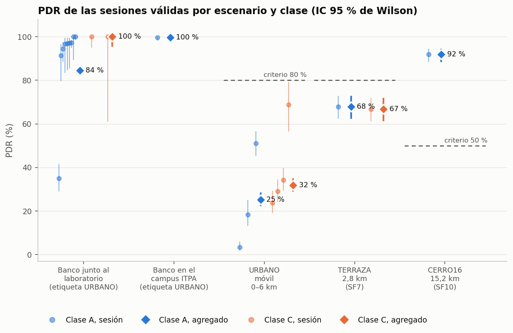
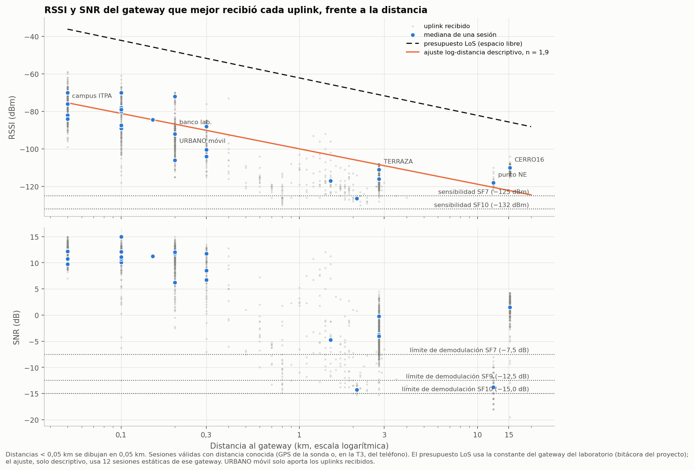
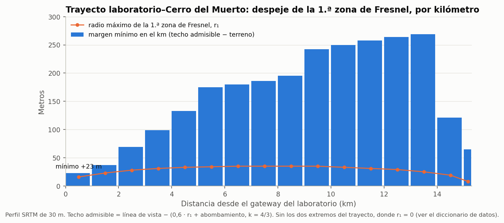
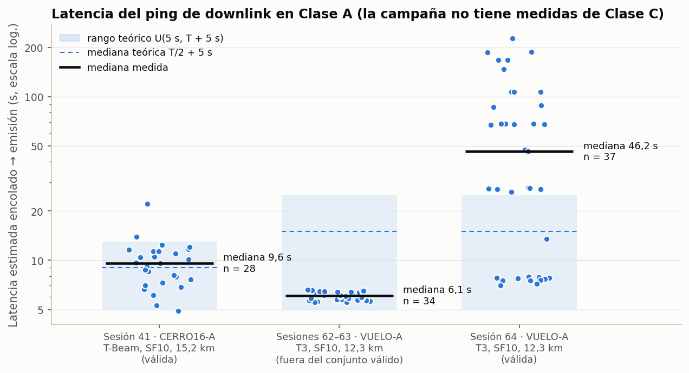
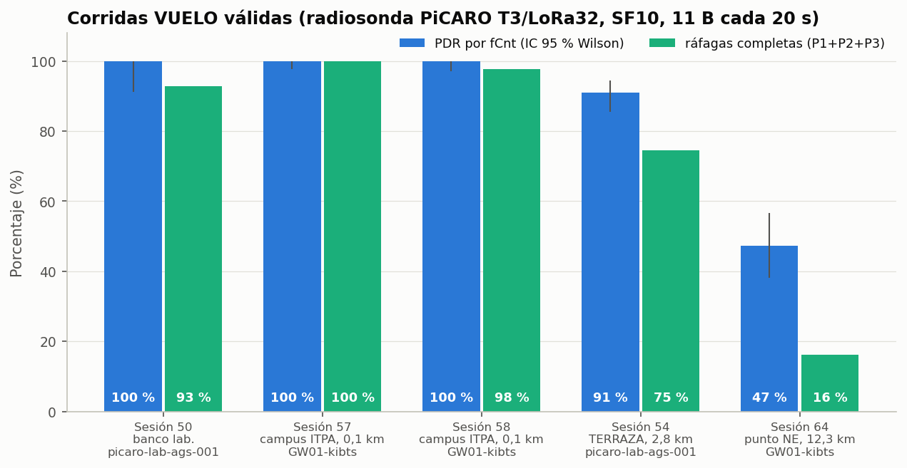

# Pruebas de terreno de la radiosonda PiCARO sobre LoRaWAN (US915)

Proyecto PiCARO: <https://pi-caro.org>

*Campaña de julio a octubre de 2026 · Instituto Tecnológico de Pabellón de Arteaga (ITPA), Aguascalientes, México · Horas en el centro de México (UTC−6).*

> **Cómo leer este reporte.** Cada cifra sale de un CSV de [`datos/`](datos/) o de un cálculo reproducible con [`scripts/t1_analisis.py`](scripts/t1_analisis.py). Lo que es inferencia y no medida directa va marcado **(inferido)**. Las pocas cifras que solo constan en la bitácora del proyecto se señalan como **(bitácora)**. El análisis completo está en [`borradores/T1-resultados.md`](borradores/T1-resultados.md) y las lecciones detalladas en [`borradores/T2-lecciones-tecnicas.md`](borradores/T2-lecciones-tecnicas.md).

---

## Contenido

1. [Resumen](#1-resumen)
2. [Objetivo y diseño experimental](#2-objetivo-y-diseño-experimental)
3. [Equipos](#3-equipos)
4. [Resultados](#4-resultados)
5. [Lecciones técnicas](#5-lecciones-técnicas)
6. [Relación con SatLink 2026](#6-relación-con-satlink-2026)
7. [Limitaciones](#7-limitaciones)
8. [Datos y reproducibilidad](#8-datos-y-reproducibilidad)
9. [Créditos](#9-créditos)

---

## 1. Resumen

Entre el 19 de julio y el 23 de octubre de 2026 se abrieron **52 sesiones de captura** con dos radiosondas PiCARO y tres gateways LoRaWAN, en la región US915 (sub-banda 2) y con un servidor ChirpStack propio. Tras aplicar un criterio de validez fijado de antemano quedan **28 sesiones válidas**. Los resultados principales son:

| Resultado | Cifra | Fuente |
|---|---|---|
| PDR en un cerro con línea de vista a **15,2 km** (SF10, Clase A) | **92,0 %** [IC 95 %: 88,3; 94,5] | [`pdr_por_sesion.csv`](borradores/t1_cifras/pdr_por_sesion.csv) |
| PDR en una terraza a 2,8 km (SF7), Clase A / Clase C | 67,9 % / 66,8 % | [`pdr_por_celda.csv`](borradores/t1_cifras/pdr_por_celda.csv) |
| PDR en recorrido urbano en vehículo (SF9), Clase A / Clase C | 25,3 % / 31,9 % (rango por sesión 3–69 %) | [`pdr_por_celda.csv`](borradores/t1_cifras/pdr_por_celda.csv) |
| El PDR depende del escenario (H1) | χ² = 563,6; p ≈ 4·10⁻¹²³ | [`contrastes_pdr.csv`](borradores/t1_cifras/contrastes_pdr.csv) |
| RSSI en el cerro frente al presupuesto en espacio libre | −110 dBm frente a −85,8 dBm (24 dB por debajo) | [`rf_por_sitio.csv`](borradores/t1_cifras/rf_por_sitio.csv) |
| Ajuste log-distancia, solo descriptivo (no es un modelo de propagación) | n = 1,89; RSSI(1 km) = −100 dBm; σ = 9 dB | [`ajuste_log_distancia.csv`](borradores/t1_cifras/ajuste_log_distancia.csv) |
| Latencia del comando en Clase A, cerro | mediana 9,6 s (teórica 9,0 s) | [`latencia_clase_a.csv`](borradores/t1_cifras/latencia_clase_a.csv) |
| Latencia en Clase A con enlace degradado (PDR 47 %) | mediana 46,2 s; máximo 226,9 s | [`latencia_clase_a.csv`](borradores/t1_cifras/latencia_clase_a.csv) |
| Downlinks recibidos por la sonda (microSD) con la clase alineada | Clase A: 21/21 en RX1 (banco) · Clase C: 4 en 3 sesiones; 7 de 14 sesiones anteriores al 29-ago tenían la clase desajustada en el servidor | [`clase_efectiva.csv`](datos/clase_efectiva.csv), [`downlinks_recibidos_sd.csv`](datos/downlinks_recibidos_sd.csv) |
| Medidas de latencia en Clase C | **ninguna** propia en esta campaña. Dato externo (SatLink 2026): mediana encolado → `txack` ≈ 1,5 s, n = 50 | [`entrega_downlinks.csv`](borradores/t1_cifras/entrega_downlinks.csv); [reporte de SatLink 2026](https://github.com/ovelazquezj/radiosonda_PIcaro/blob/master/docs/reportes/satlink-2026/REPORTE-SATLINK-2026.md) |
| Paquete de telemetría de vuelo (11 B, SF10) | 370,7 ms en el aire; ciclo de trabajo 1,85 % | cálculo en [`t1_analisis.py`](scripts/t1_analisis.py) |

En pocas palabras: **la geometría del trayecto pesa más que la distancia**. El punto más lejano, el cerro, es el que mejor entrega. El presupuesto de enlace en espacio libre resultó unos 24 dB optimista incluso en el mejor caso. SF7 trabaja en el límite ya a 2,8 km, mientras que SF10 en el mismo sitio deja +10 dB de margen. La Clase A se comporta como predice la teoría. La comparación con la Clase C, que era una de las preguntas centrales, **quedó sin medir** en esta campaña: un fallo de la pila LoRaWAN, que se diagnosticó y corrigió durante la campaña, dejó sin datos las corridas de Clase C del cerro (§5). La única medida de Clase C sobre esta misma red es externa, del vuelo de SatLink 2026 (§4.3).

La campaña sirvió de preparación al evento [Misiones Espaciales · SatLink 2026](#6-relación-con-satlink-2026). Validó la infraestructura de gateways y servidor, el formato de telemetría en SF10 y varias prácticas de operación.

---

## 2. Objetivo y diseño experimental

### 2.1 Objetivo

Caracterizar el comportamiento de una radiosonda LoRaWAN en condiciones de propagación representativas y cuantificar el coste y el beneficio de operar en **Clase C** frente a **Clase A**. Las preguntas de partida fueron:

| ID | Pregunta |
|---|---|
| P1 | ¿Qué PDR se obtiene en cada escenario y cómo evoluciona con la distancia? |
| P2 | ¿Cuánto reduce la autonomía la Clase C (receptor siempre activo)? |
| P3 | ¿Cuánto se reduce la latencia del comando de corte en Clase C? |
| P4 | ¿Es viable un enlace de ~15 km con SF10 y línea de vista con el gateway disponible? |

Las hipótesis se pre-registraron con criterio numérico en el protocolo del experimento:

| Hipótesis | Enunciado | Contraste y criterio |
|---|---|---|
| **H1** | El PDR difiere entre escenarios | χ² de independencia, α = 0,05 |
| **H2** (control) | El PDR **no** difiere entre Clase A y C en el mismo escenario | χ² por escenario; «problema de método» solo si es significativo **y** Δ > 5 pp |
| **H3** | La Clase C consume más corriente | *t* pareado; Δ ≥ 3 mA |
| **H4** | La latencia del comando es menor en Clase C | U de Mann-Whitney; mediana(C) ≤ 1 s y mediana(A) ≥ 0,4 × intervalo |
| **H5** | El enlace al cerro con SF10 es viable | PDR ≥ 50 % y SNR mediano ≥ −15 dB, con IC de Wilson |

**H3 salió del trabajo de campo** antes de empezar, por dos razones. El gestor de energía de la placa (AXP2101) no mide corriente. Y en una corrida de ~40 min la diferencia esperada entre clases (≈ 1,4 mV de caída de tensión) es un orden de magnitud menor que el ruido de la lectura (5–20 mV). Se trasladó a un ensayo de banco con medidor de corriente que **todavía no se ha hecho**, así que este reporte no responde a P2.

### 2.2 Escenarios

| Escenario | Sitio | DR / SF | Intervalo de uplink | Distancia al gateway |
|---|---|---|---|---|
| **URBANO** | Recorrido en vehículo por la ciudad de Aguascalientes, sin línea de vista | DR1 / SF9 | 7 s | 0–6 km |
| **TERRAZA** | Terraza de un quinto piso, ciudad de Aguascalientes | DR3 / SF7 | 7 s | 2,8 km |
| **CERRO16** | Cima de un cerro al OSO (Cerro del Muerto), con línea de vista | DR0 / SF10 | 8 s | 15,2 km |
| **VUELO** | Corrida de la telemetría de vuelo (3 paquetes de 11 B cada 20 s) | DR0 / SF10 | 20 s | de banco a 12,3 km |

Cada corrida tiene un objetivo de **300 uplinks** (165 en VUELO), con **ADR desactivado** para que el DR sea una variable controlada. El `fPort` identifica la corrida (escenario × clase), así que cada paquete va autoetiquetado sin gastar bytes de carga útil.

**El escenario se define por el sitio, no por la etiqueta.** Durante la campaña, la etiqueta URBANO también se usó en pruebas estáticas junto a un gateway. En el análisis se separan el recorrido en vehículo (URBANO móvil) y los bancos junto al laboratorio o en el campus del ITPA. El sitio de cada sesión se asigna por la mediana y la dispersión de sus posiciones **(inferido)**.

### 2.3 Clase A frente a Clase C

En **Clase A** la sonda solo escucha en dos ventanas breves después de cada uplink. Un comando enviado desde tierra espera al siguiente uplink y sale `rx1_delay` segundos después (5 s en este servidor). En **Clase C** el receptor está siempre abierto y el comando debería llegar en cuanto el servidor lo emite. La diferencia importa en una radiosonda porque el **comando de corte** de la carga útil es urgente.

Para medir la latencia, el microservicio de campo encolaba un *ping* de downlink (1 byte de secuencia) cada 60 s mientras la sesión estaba abierta, y registraba cada envío. La clase no afecta al enlace ascendente, y por eso H2 funciona como **control gratuito** del método. Si el PDR cambiara entre A y C en el mismo sitio, el fallo sería del método, no del fenómeno.

### 2.4 Métricas

| Métrica | Definición |
|---|---|
| **PDR** | Paquetes recibidos por el servidor / paquetes enviados por el aire, con IC 95 % de Wilson |
| **RSSI, SNR** | Del mejor gateway que recibió cada uplink; se reportan mediana y percentil 10 |
| **Margen de SNR** | SNR p10 − límite de demodulación del SF (−7,5 dB en SF7, −12,5 dB en SF9, −15 dB en SF10; valores de Semtech) |
| **Latencia del ping (Clase A)** | Uplink que abre la ventana + 5 s (RX1) − instante de encolado. **(inferido: es la emisión estimada, no la recepción en la sonda)** |
| **Entrega de downlinks** | Pings con confirmación de transmisión del gateway (`txack`) / pings encolados |
| **Ráfagas completas (VUELO)** | Lecturas con sus tres paquetes recibidos, comparadas con (PDR)³ |

### 2.5 Por qué dos fuentes de datos

El servidor de red sabe muy bien qué llegó, pero no sabe qué se envió. Por eso el diseño cruza dos registros:

| Fuente | Qué aporta | Qué no puede aportar |
|---|---|---|
| **Sonda → microSD**, una fila por intento de transmisión (contador `fCnt`, hora GNSS, código de retorno de la radio) | El **denominador**: lo enviado, incluidos los fallos en la propia radio | La calidad del enlace |
| **Servidor → base de datos**, una fila por uplink recibido | El **numerador** y la calidad del enlace (RSSI, SNR, gateway, frecuencia, DR) | Lo que nunca llegó |

La clave de unión es el `fCnt` y la hora común es la UTC del GNSS. Cuando falta la microSD, el PDR se estima por los huecos del `fCnt` recibido. Ese método no ve las pérdidas anteriores al primer uplink ni las posteriores al último y, por tanto, **sobrestima** el PDR. Los datos lo muestran:

| Corrida | PDR por huecos de `fCnt` | PDR con microSD |
|---|---|---|
| URBANO-A, 18-ago (sesión 23) | 6,5 % (10 de 155) | **3,3 %** (10 de 300) |
| URBANO-A, 21-ago (sesión 25) | 59,2 % (29 de 49) | **18,3 %** (30 de 164) |
| TERRAZA-C, 17-ago (sesión 20) | 67,3 % (202 de 300) | **66,8 %** (199 de 298 al aire) |

Fuente: [`sesiones.csv`](datos/sesiones.csv) (`pdr_fcnt`) y [`pdr.csv`](datos/pdr.csv). Los recibidos no coinciden exactamente entre las dos fuentes, y la diferencia tiene explicación:

- **Sesión 25 (29 frente a 30).** La microSD registra dos transmisiones con el mismo `fCnt` 0, separadas 8 s. El servidor lo recibió una sola vez, pero el cruce por `fCnt` lo cuenta para las dos. El valor real es 29 de 164 (17,7 %). El agregado de URBANO móvil en Clase A pasaría de 25,3 % a 25,1 %.
- **Sesión 20 (202 frente a 199).** El servidor recibió tres paquetes que el cruce no cuenta como enviados al aire. Uno es el `fCnt` 599, posterior al último registro de la microSD (huérfano). Los otros dos son los `fCnt` 576 y 594, que la microSD marcó con un código de error de la radio (`tx_rc ≠ 0`) aunque llegaron al servidor. Ese código, por tanto, no garantiza que el paquete no saliera.

De las 28 sesiones válidas, **12 tienen microSD**. Las otras 16, entre ellas TERRAZA-A, la del cerro y todas las VUELO, usan el método de `fCnt` y se leen como **cota superior**.

### 2.6 Criterio de validez

Una sesión entra al análisis si cumple tres condiciones:

1. Terminó, o se abortó con al menos 30 intentos.
2. No es una prueba de banco con la etiqueta de otro escenario.
3. No es una repetición abortada y rehecha el mismo día en el mismo sitio.

Además se excluye la sesión 66 por un incidente (§5). Quedan fuera 24 sesiones, cada una por su motivo principal:

| Motivo | Sesiones |
|---|---|
| Abortada con menos de 30 intentos | 15 |
| Banco con la etiqueta de otro escenario | 4 |
| Repetida | 4 |
| Incidente | 1 |

Fuente: [`sesiones.csv`](datos/sesiones.csv) (`valida_para_analisis`, `motivo_exclusion`) y [`borradores/t1_cifras/exclusiones.csv`](borradores/t1_cifras/exclusiones.csv). El criterio completo está en [`datos/DICCIONARIO.md`](datos/DICCIONARIO.md).

---

## 3. Equipos

### 3.1 Radiosondas

| Sonda | Placa y radio | Sensores | Pila | Uso en la campaña |
|---|---|---|---|---|
| **Radiosonda PiCARO (T-Beam Supreme)** | ESP32-S3 + Semtech SX1262 | GNSS, BME280 y gestor de energía AXP2101 reales; microSD | ESP-IDF + RadioLib 7.7.1 | URBANO, TERRAZA, CERRO16 y VUELO de banco |
| **Radiosonda PiCARO (T3/LoRa32)** | ESP32 + Semtech SX1276 | **Simulados** (GPS, BME280, magnetómetro); solo la batería y el tiempo de funcionamiento son reales | — | Corridas VUELO de octubre |

Las dos sondas usan la misma carga útil de 11 bytes en SF10 y el mismo decodificador en el servidor, así que en VUELO se compara **el enlace, no la telemetría**. En las corridas de la T3, la posición la da el GPS de un teléfono que viaja junto a la sonda.

### 3.2 Gateways

| Gateway | Equipo | Protocolo | Ubicación |
|---|---|---|---|
| `picaro-lab-ags-001` | SenseCAP M2, 8 canales | Basics Station con TLS mutuo | Laboratorio en la ciudad de Aguascalientes, a unos 25–30 km al sur del ITPA; antena dipolo RAIGEN de fibra de vidrio de 5,8 dBi, a ~15 m sobre el suelo. Su posición no se publica (§8) |
| `ITPA-IOT-GW00` | SenseCAP M2, 8 canales | Semtech UDP | Campus del ITPA, Pabellón de Arteaga |
| `ITPA-IOT-GW01-kibts` | Kerlink Wirnet iBTS | Semtech UDP | Campus del ITPA, Pabellón de Arteaga |

Los tres escuchan los 8 canales de 125 kHz de la sub-banda 2 (903,9–905,3 MHz). Los escenarios URBANO, TERRAZA y CERRO16 se miden contra el gateway del laboratorio, y las corridas VUELO de octubre, sobre todo contra los dos del ITPA.

### 3.3 Servidor de red

ChirpStack v4 (4.19), región US915, sub-banda 2, en un servidor remoto, con un tiempo de ida y vuelta de ~180 ms **(bitácora)**. Por eso el servidor usa `rx1_delay = 5 s`. La configuración global del servidor es **compartida** con otros proyectos y no se modificó para el experimento: solo se añadieron dos *device profiles* (Clase A y Clase C). Un microservicio de campo, operado desde una app móvil, abre y cierra cada sesión, conmuta el perfil, encola los pings y guarda los uplinks.

---

## 4. Resultados

### 4.1 PDR por escenario y clase



*Figura 1. Cada punto claro es una sesión con su IC 95 % de Wilson; el rombo es el agregado de la celda. Las líneas discontinuas marcan el criterio pre-registrado: 80 % en URBANO y TERRAZA, 50 % en CERRO16.*

| Escenario | Clase | Sesiones | Recibidos / intentados | PDR [IC 95 %] | Rango por sesión | Criterio |
|---|---|---|---|---|---|---|
| URBANO móvil, 0–6 km, SF9 | A | 3 | 193 / 764 | **25,3 %** [22,3; 28,5] | 3,3–51,0 % | 80 % ✗ |
| URBANO móvil | C | 4 | 294 / 922 | **31,9 %** [29,0; 35,0] | 23,8–68,9 % | 80 % ✗ |
| TERRAZA, 2,8 km, SF7 | A | 1 | 203 / 299 | **67,9 %** [62,4; 72,9] | — | 80 % ✗ |
| TERRAZA | C | 1 | 199 / 298 | **66,8 %** [61,2; 71,9] | — | 80 % ✗ |
| CERRO16, 15,2 km, SF10 | A | 1 | 275 / 299 | **92,0 %** [88,3; 94,5] | — | 50 % ✓ |
| CERRO16 | C | — | sin datos (0 uplinks, §5) | — | — | — |
| *Banco junto al laboratorio, SF9* | A | 9 | 902 / 1068 | 84,5 % [82,2; 86,5] | 35,0–100 % | — |
| *Banco junto al laboratorio* | C | 2 | 81 / 81 | 100 % [95,5; 100] | — | — |
| *Banco en el campus del ITPA* | A | 1 | 299 / 300 | 99,7 % [98,1; 99,9] | — | — |
| *Banco sin posición (sesión 36)* | A | 1 | 300 / 300 | 100 % [98,7; 100] | — | — |

Fuente: [`borradores/t1_cifras/pdr_por_celda.csv`](borradores/t1_cifras/pdr_por_celda.csv). La tabla recoge 23 de las 28 sesiones válidas; las otras 5 son corridas VUELO (§4.4). La sesión 36 no tiene posición. La recibió `ITPA-IOT-GW00` a −22 dBm cuando ese gateway todavía no estaba en el ITPA, así que se trata como un banco sin sitio y no aparece en la figura 1 **(inferido)**.

- **H1 se confirma (se rechaza H0):** χ² = 563,6, gl = 2, p ≈ 4·10⁻¹²³ entre URBANO móvil, TERRAZA y CERRO16. El orden es el contrario al de la distancia.
- **H5 se acepta:** 92,0 % ≥ 50 %, con un SNR mediano de +1,5 dB ≥ −15 dB. Es un PDR por `fCnt`, porque la microSD de esa sesión no se ha descargado.
- **Ni URBANO móvil ni TERRAZA llegan al 80 %.** En URBANO la heterogeneidad entre sesiones es enorme (χ² de homogeneidad p ≈ 4·10⁻⁴¹ en A y 2·10⁻¹⁰ en C). Cada recorrido es un canal distinto, y es más honesto citar el rango por sesión (3–69 %) que el IC del agregado.
- **H2, el control, funciona donde el diseño se cumple.** Hay tres contrastes A/C ([`contrastes_pdr.csv`](borradores/t1_cifras/contrastes_pdr.csv)):
  - En TERRAZA, el único par A/C del mismo día y sitio, Δ = +1,1 pp con p = 0,77: sin problema de método.
  - En URBANO móvil sale Δ = −6,6 pp con p = 0,003. Pero las corridas no recorrieron la misma ruta, y una de ellas (sesión 23, 3,3 %) estuvo casi parada. **(inferido)** La diferencia es del canal y no de la clase: sin la sesión 23, la Clase A sube al 39,4 %, por encima de la C.
  - En el banco junto al laboratorio sale Δ = −15,5 pp con χ² = 14,7 y p = 1,2·10⁻⁴. Con el criterio pre-registrado eso también es «problema de método». Pero la comparación no es pareada: la Clase A reúne 9 sesiones muy heterogéneas (35–100 %), y la Clase C, solo 2 sesiones cortas con 81 paquetes. La diferencia la produce una sola sesión de Clase A, la 29 (35 % a 0,1 km), que los datos no explican; sin ella, la Clase A da el 97,5 % **(inferido)**.
  - En los dos casos significativos, el diseño (corridas A y C pareadas en el mismo sitio y la misma ruta) no se cumplió, así que el contraste no puede separar la clase del canal.

### 4.2 Enlace: RSSI, SNR, presupuesto y Fresnel



*Figura 2. Uplinks recibidos de las sesiones válidas con distancia conocida (gris), mediana por sesión (azul), presupuesto en espacio libre (discontinua) y ajuste log-distancia descriptivo (naranja). En URBANO móvil solo hay distancia de los uplinks recibidos, con sesgo hacia el gateway.*

| Sitio | SF | Distancia mediana | RSSI mediano | SNR mediano | Margen de SNR en el p10 | Pérdida sobre el espacio libre |
|---|---|---|---|---|---|---|
| Banco del laboratorio | 9 | 0,2 km | −90 dBm | +11,5 dB | +20,0 dB | 42 dB |
| URBANO móvil (solo recibidos) | 9 | 0,2 km | −100 dBm | +8,8 dB | **+1,7 dB** | 52 dB |
| TERRAZA, T-Beam | **7** | 2,8 km | −116 dBm | −3,8 dB | **+0,2 dB** | 45 dB |
| TERRAZA, T3 | 10 | 2,8 km | −111 dBm | −0,2 dB | +10,0 dB | 40 dB |
| Punto NE, 12,3 km del ITPA (sesión 64) | 10 | 12,3 km | −118 dBm | −13,8 dB | **−2,0 dB** | 34 dB |
| CERRO16 | 10 | 15,2 km | −110 dBm | +1,5 dB | **+14,0 dB** | 24 dB |

Fuente: [`borradores/t1_cifras/rf_por_sitio.csv`](borradores/t1_cifras/rf_por_sitio.csv).

- **El presupuesto en espacio libre es optimista.** Para el cerro preveía −85,8 dBm y un margen de unos +44 dB en SF10 **(bitácora)**. Se midieron −110 dBm, 24 dB menos, con un margen real en el p10 de +14 dB. Un pronóstico extrapolado con *n* = 2 desde el mejor punto de banco (−108,7 dBm, bitácora) acertó dentro de 2 dB.
- **Ajuste log-distancia (descriptivo, no es un modelo de propagación).** Doce sesiones estáticas contra el gateway del laboratorio, de 0,1 a 15,2 km, dan un exponente **n = 1,89**, RSSI(1 km) = −100 dBm y una desviación residual de 9,0 dB. El ajuste mezcla geometrías muy distintas: bancos urbanos sin línea de vista a 0,1–0,3 km y un único punto con línea de vista a 15,2 km, el cerro. Un exponente menor que 2 sale de esa mezcla y del sesgo en la elección de sitios, no de la propagación. Con σ = 9 dB, el ajuste predice poco: en el cerro daría unos −122 dBm, y se midieron −110 dBm. La pérdida sobre el espacio libre tampoco es fija: va de **24 dB a 52 dB según el sitio** (tabla anterior). **(inferido)** Parte de esa pérdida es común a todos los sitios y apunta a la instalación (cables, conectores, ganancia real de las antenas, sonda a 1,5 m del suelo); el resto depende de la geometría de cada trayecto.
- **El SF separa la terraza del cerro, no la distancia.** En TERRAZA, con SF7, el p10 del SNR cae justo en el límite de demodulación (+0,2 dB), y las pérdidas son la cola de paquetes por debajo del umbral. En el mismo sitio, con SF10, la T3 deja +10 dB.
- **Piso de ruido aparente (inferido).** En los paquetes con SNR < 0, RSSI − SNR da entre −111 y −114 dBm en el gateway del laboratorio. Eso queda de 3 a 6 dB por encima del ruido térmico en 125 kHz con NF = 6 dB (−117 dBm). Es compatible con interferencia urbana, pero es una estimación indirecta y no una medida del espectro.



*Figura 3. Margen mínimo de cada kilómetro del trayecto sobre el techo admisible = línea de vista − (0,6 · r₁ + abombamiento terrestre con k = 4/3), con el perfil SRTM de 30 m. El perfil fino del terreno no se publica porque permitiría situar el laboratorio.*

El trayecto al cerro está **despejado en todo su tramo interior** ([`perfil_cerro.csv`](datos/perfil_cerro.csv)). El margen mínimo es de **+23 m en el primer kilómetro**, en el entorno urbano junto al gateway, y la mediana de los mínimos por kilómetro es de 178 m. El radio de la primera zona de Fresnel llega a 35 m en el punto medio.

Los dos extremos quedan fuera de ese mínimo porque ahí r₁ = 0 y el margen es solo la altura de cada antena sobre el terreno SRTM. En el lado del gateway, la antena está a unos 15 m sobre el suelo. En la cima, el perfil usa como altitud de la sonda la mediana de su GPS más 1,5 m (2274 + 1,5 m, [`sitios.csv`](datos/sitios.csv)), y el SRTM da 2269 m: la sonda queda 6,5 m por encima. En un pico, una diferencia de unos metros entre el SRTM de 30 m y el GPS está dentro del error de ambos.

Las pérdidas del cerro fueron sueltas y se concentraron en un canal: 905,3 MHz recibió 17 uplinks, frente a 35–38 en cada uno de los otros siete ([`telemetria.csv`](datos/telemetria.csv)). Eso apunta a interferencia y no a geometría **(inferido)**.

### 4.3 Downlinks: entrega, latencia y RTT

#### Clase A frente a Clase C: la clase que de verdad tuvo cada corrida

Para comparar las clases en el enlace de bajada hay que saber **qué clase aplicaba el servidor**, no solo cuál decía la etiqueta de la corrida. ChirpStack fija la clase del dispositivo en el *join* (lección 6 en §5). La sonda, en cambio, opera con la clase de la corrida. Cada uplink que guardó el microservicio trae la clase efectiva del servidor (`deviceClassEnabled`). Con ese campo se reconstruyó la combinación real de cada sesión ([`datos/clase_efectiva.csv`](datos/clase_efectiva.csv)), y se cruzó con los downlinks que **la propia sonda registró en su microSD** ([`datos/downlinks_recibidos_sd.csv`](datos/downlinks_recibidos_sd.csv)).

| Combinación (sonda / servidor) | Sesiones | Downlinks recibidos por la sonda (microSD) | Qué significa |
|---|---|---|---|
| **A / A** (coinciden) | 30, 32, 33, 35 (banco, 29–30 ago) | **27**, todos en RX1, entre 5 y 6 s después del uplink | La Clase A funciona como dice la norma. En 32, 33 y 35 la sonda registró **21 de 21** pings enviados |
| **C / C** (coinciden) | 20 (TERRAZA), 24 y 28 (URBANO); la 31 no tiene microSD | **4**: 3 en la 20 (secuencias 1, 3 y 4) y 1 en la 24 | La Clase C entregó comandos en la terraza y en ciudad |
| **A / C** (desajuste) | 19, 21, 25, 29 | **0** en las que tienen microSD (21 y 25) | El servidor cree que la sonda escucha siempre y transmite por RX2 cuando la sonda está sorda: es el origen del 0/764 de la Serie 1 |
| **C / A** (desajuste) | 3, 18, 22 | 0 en las que tienen microSD (18 y 22) | La sonda escucha siempre, pero el servidor solo transmite tras un uplink: mediría la latencia de la clase equivocada |

**7 de las 14 sesiones con uplinks anteriores al 29 de agosto corrieron con la clase desajustada.** Por eso la comparación de downlinks por etiqueta no vale, y por eso se introdujo la verificación de clase al abrir cada sesión. Desde el 29 de agosto, todas las sesiones coinciden.

**Qué se puede afirmar y qué no:**

- **Entrega:** con las clases alineadas, **las dos clases entregaron comandos**. Con la clase desajustada, en un sentido no se entregó ninguno.
- **Latencia en Clase C: no se puede medir en esta campaña.** En la Serie 1, los pings eran manuales y su hora de envío no se guardaba: la tabla de envíos existe desde el 29 de agosto. Además, la microSD de esa serie fecha cada downlink con la misma hora que el uplink en curso **(inferido: coinciden al segundo en los 6 casos)**, así que tampoco demuestra que la recepción ocurriera fuera de las ventanas de Clase A. Las sesiones de Clase C del cerro (42 y 43), que ya tenían el ping automático, se quedaron sin uplinks porque la sonda no completó el join (lección 8 en §5).
- **Latencia de extremo a extremo en Clase A, desde la microSD: tampoco es fiable.** El reloj de la sonda llevaba desfases de minutos respecto al servidor en las sesiones del banco, y solo una sesión permite calibrarlo con los propios uplinks. Lo que sí confirma la microSD es la **fase**: cada ping de Clase A llegó entre 5 y 6 s después del uplink que abrió la ventana, coherente con `rx1_delay = 5 s`.
- Por todo esto, **H4 sigue sin contrastarse con datos propios**. La comparación de latencias que sí existe es la de Clase A medida en el servidor (abajo) frente a la Clase C medida en SatLink 2026 (dato externo, al final de esta sección).

**Entrega en Clase A.** En las dos sesiones válidas con pings, el gateway confirmó la transmisión de casi todos, siempre por la ventana RX1:

| Sesión | Sonda · sitio | Pings encolados con captura de `txack` | Emitidos | Fracción |
|---|---|---|---|---|
| 41 | T-Beam · CERRO16 | 29 | 28 | **96,6 %** |
| 64 | T3 · punto NE | 39 | 37 | **94,9 %** |

Que un ping se emita no garantiza que la sonda lo reciba; para saberlo hace falta un registro en la microSD.



*Figura 4. Latencia estimada de cada ping (inferido). La franja es el rango teórico U(5 s, T + 5 s), con T el periodo de uplink, y la línea discontinua, la mediana teórica T/2 + 5 s. Las sesiones 62–63 no son válidas para el PDR y se muestran solo como referencia.*

| Grupo | n | Periodo de uplink | Mediana medida [p25–p75] | Mediana teórica | Máximo | Por encima de T + 5 s |
|---|---|---|---|---|---|---|
| 41 · cerro (válida) | 28 | 8 s | **9,6 s** [7,6–11,4] | 9,0 s | 22,2 s | 7,1 % |
| 62–63 · punto NE (no válidas) | 34 | 20 s | 6,1 s [5,7–6,4] | 15,0 s | 6,6 s | 0 % |
| 64 · punto NE (válida) | 37 | 20 s | **46,2 s** [7,9–88,1] | 15,0 s | 226,9 s | 67,6 % |

Fuente: [`borradores/t1_cifras/latencia_clase_a.csv`](borradores/t1_cifras/latencia_clase_a.csv).

- **En el cerro, la Clase A sigue el modelo.** La mediana queda a 0,6 s de la teórica. La fracción de pings por encima de T + 5 s (7,1 %) coincide con la pérdida de uplinks de la sesión (8,0 %): cuando se pierde el uplink que debía abrir la ventana, el comando espera un periodo más.
- **Con un enlace degradado, la Clase A se dispara.** En la sesión 64, con un PDR del 47 %, dos de cada tres pings superaron T + 5 s y el peor tardó casi 4 minutos. Para un comando de corte, ese es el argumento a favor de la Clase C, o de más redundancia, en el borde de la cobertura.
- **Los ~6 s de las sesiones 62–63 son un artefacto (inferido).** El ping de 60 s es múltiplo exacto del ciclo de 20 s, así que quedó en fase y siempre se encoló justo antes de un uplink. No representa la latencia de un comando que llega en un instante al azar.

**Cota del tiempo de red (inferido).** El SenseCAP `ITPA-IOT-GW00`, por UDP, confirma la orden al recibirla. Del uplink al `txack` pasan **0,64 s** de mediana (0,63–0,73 s, n = 14), que incluyen la subida al servidor, la deduplicación, el proceso y la bajada. Los otros dos gateways confirman tras emitir en RX1: 5,05 s el Kerlink y 5,26 s el de Basics Station ([`rtt_uplink_txack.csv`](borradores/t1_cifras/rtt_uplink_txack.csv)). En Clase C el comando sale por RX2 (923,3 MHz, SF12 a 500 kHz), así que a esos 0,5–1 s de red hay que sumar unos 250–290 ms de tiempo en el aire. La latencia esperada queda, por tanto, **en el umbral de 1 s de H4 o por encima**, no por debajo.

**Dato externo: la Clase C medida en SatLink 2026.** En el evento, una de las sondas, la de Orbitium (Sci-Fi), ITPA, voló en Clase C sobre el mismo servidor y los gateways del ITPA. En sus 50 downlinks, del encolado al `txack` pasó una mediana de **≈ 1,5 s**: 1,19 s por `ITPA-IOT-GW00`, que confirma al aceptar la orden, y 2,10 s por `ITPA-IOT-GW01-kibts`, que confirma tras emitir. La hora de encolado tiene una resolución de 1 s ([reporte de SatLink 2026](https://github.com/ovelazquezj/radiosonda_PIcaro/blob/master/docs/reportes/satlink-2026/REPORTE-SATLINK-2026.md), [`downlinks.csv` de SatLink 2026](https://github.com/ovelazquezj/radiosonda_PIcaro/blob/master/docs/reportes/satlink-2026/datos/downlinks.csv)). No es una medida de esta campaña ni de estas sondas, así que H4 sigue sin contrastarse, pero el orden de magnitud es claro: en Clase C el comando tarda 1–2 s, frente a los 9,6 s de mediana de la Clase A en el cerro.

### 4.4 Corridas VUELO: telemetría de 11 bytes

Cada lectura de vuelo se reparte en **tres paquetes de 11 bytes** en SF10 (posición, ambiente y navegación), separados 20 s. Cada paquete (24 B en la capa física, SF10/125 kHz, CR 4/5) ocupa **370,7 ms** en el aire, dentro del límite de 400 ms de US915. El ciclo de trabajo es del **1,85 %**.



*Figura 5. Sesiones VUELO válidas, todas de la radiosonda PiCARO (T3/LoRa32): PDR por `fCnt` con IC 95 % de Wilson y fracción de ráfagas con los tres paquetes.*

| Sesión | Sitio | Gateway principal | Distancia | PDR por `fCnt` [IC 95 %] | Ráfagas completas | (PDR)³ |
|---|---|---|---|---|---|---|
| 50 | Banco del laboratorio | picaro-lab-ags-001 | < 0,1 km | 100 % [91,2; 100] | 13/14 (92,9 %) | 100 % |
| 57 | Campus del ITPA | ITPA-IOT-GW01-kibts | 0,1 km | 100 % [97,7; 100] | 55/55 (100 %) | 100 % |
| 58 | Campus del ITPA | ITPA-IOT-GW01-kibts | 0,1 km | 100 % [97,1; 100] | 42/43 (97,7 %) | 100 % |
| 54 | TERRAZA | picaro-lab-ags-001 | 2,8 km | 90,9 % [85,5; 94,4] | 41/55 (74,5 %) | 75,1 % |
| 64 | Punto NE | ITPA-IOT-GW01-kibts | 12,3 km | 47,3 % [38,2; 56,5] | 6/37 (16,2 %) | 10,6 % |

Fuente: [`borradores/t1_cifras/vuelo_por_sesion.csv`](borradores/t1_cifras/vuelo_por_sesion.csv).

- **Las ráfagas se completan como predicen las pérdidas independientes.** En TERRAZA se midió un 74,5 % frente al 75,1 % esperado. Repartir la lectura en el tiempo cumple su objetivo: una interferencia breve no se lleva una lectura entera. En las sesiones 50 y 58, la ráfaga que falta es la última, cortada al cerrar la sesión.
- **Diversidad en el ITPA.** En las sesiones 57 y 58, el 97 % de los uplinks llegó por los dos gateways del campus.
- **Punto NE, a 12,3 km del ITPA (inferido).** La sesión 63 (repetida, no válida) dio un 97,5 % con SNR de +6,0 dB en el mejor gateway, +21 dB sobre el límite de SF10. Minutos después, en el mismo sitio, la 64 bajó al 47,3 % con −13,9 dB, y los dos gateways empeoraron a la vez ([`punto_ne_62_64.csv`](borradores/t1_cifras/punto_ne_62_64.csv)). Algo cambió en la sonda o en su colocación, pero ningún registro lo confirma.
- **No hay comparación válida T-Beam frente a T3 en VUELO.** Las VUELO de la T-Beam son solo de banco (100 % de entrega) y quedan excluidas. La única comparación en el mismo sitio es TERRAZA: 67,3 % la T-Beam en SF7 frente a 90,9 % la T3 en SF10. Está confundida con el SF, la placa, la antena y la fecha.

---

## 5. Lecciones técnicas

Resumen de las nueve lecciones de [`borradores/T2-lecciones-tecnicas.md`](borradores/T2-lecciones-tecnicas.md), pensadas para otras instituciones que monten una radiosonda o un experimento de cobertura LoRaWAN con un servidor ChirpStack propio.

| # | Lección | En pocas palabras |
|---|---|---|
| 1 | **Dos fuentes para el PDR** | Sin el registro del emisor no se distingue «no se envió» de «se perdió». El PDR calculado solo con el servidor puede salir inflado: 6,5 % aparente frente a 3,3 % real. |
| 2 | **La tabla de DR de US915 no es la de EU868** | En US915, DR0 = SF10, DR1 = SF9, DR3 = SF7 y DR4 = SF8 a 500 kHz. Tómala de los *Regional Parameters* y compruébala en el `txInfo` del servidor. |
| 3 | **SF10 obliga a 11 bytes** | En US915 no hay SF11 ni SF12 de subida. Con 11 B el paquete ocupa 370,7 ms; con 12 B, 411,6 ms, fuera del límite de 400 ms. Diseña la carga útil para el DR más lento. |
| 4 | **El join también va a SF10** | RadioLib envía el JoinRequest en DR0, con el mismo alcance que los datos. Compruébalo antes de ir a un sitio lejano. |
| 5 | **`rx1_delay` fija el intervalo mínimo en Clase A** | Con 5 s, el ciclo mínimo ronda 6,5 s. Bajarlo en la configuración global de un servidor compartido rompió el join de otro proyecto. Los intervalos se derivan de los temporizadores del servidor, nunca al revés. |
| 6 | **ChirpStack congela la clase en el JOIN** | Cambiar el *device profile* por la API no cambia la clase efectiva hasta el siguiente join. Solución: el microservicio lee la clase efectiva y rechaza la sesión si no coincide, y la app ordena a la sonda rehacer el join. |
| 7 | **El ping debe vivir dentro de la sesión, y la sesión debe morir sola** | Una sesión que quedó abierta 10,12 días encoló 14 526 pings, 14 521 de ellos tras el último uplink ([`incidentes.csv`](datos/incidentes.csv)). Todo proceso periódico necesita una señal de vida del otro extremo. |
| 8 | **RadioLib: una JoinAccept ajena envenena el nodo** | RadioLib 7.7.1 fija la revisión LoRaWAN con cualquier JoinAccept que oiga, antes de verificar el MIC; desde entonces todos los JoinRequest salen con MIC inválido. Solución: reconstruir el nodo tras cada join fallido, conservando solo los *nonces*. Por esto quedó sin medir la Clase C del cerro. |
| 9 | **Fresnel y perfil SRTM antes de salir** | El despeje de Fresnel decide si el enlace existe. Hay que medir la altitud real de la antena (la curva de nivel daba un error de 86 m, según la bitácora) y pronosticar desde medidas reales, no desde el espacio libre. |

**Lecciones cortas.**

- Las pérdidas pueden concentrarse en un solo canal, como 905,3 MHz en el cerro.
- ChirpStack entrega los números del codec como *double*: un `0` llega como `0.0`.
- El instante del `txack` depende del tipo de gateway.
- Un ping con periodo múltiplo del uplink mide una latencia falsa.
- Un gateway «en línea» puede estar sordo: hay que vigilar los paquetes recibidos, no solo su latido.
- Abrir el puerto serie de un ESP32 lo reinicia. Una sonda en plena corrida no se conecta al PC «solo para mirar».

---

## 6. Relación con SatLink 2026

Esta campaña **sirvió de preparación** al evento *Misiones Espaciales · SatLink · Edición 2026*, celebrado el 28 de octubre de 2026 en el ITPA con lanzamientos nocturnos de globos estratosféricos. El reporte del evento está en [`REPORTE-SATLINK-2026.md`](https://github.com/ovelazquezj/radiosonda_PIcaro/blob/master/docs/reportes/satlink-2026/REPORTE-SATLINK-2026.md).

Lo que la campaña aportó al evento:

- **Infraestructura probada.** Las corridas VUELO de octubre ejercitaron los dos gateways del campus del ITPA (`ITPA-IOT-GW00` e `ITPA-IOT-GW01-kibts`), los mismos que recibieron los vuelos. Mostraron diversidad de recepción entre ambos: en las sesiones 57 y 58, el 97 % de los uplinks llegó por los dos.
- **Un dato de alcance cerca del sitio de lanzamiento.** En el punto NE, a 12,3 km del ITPA, el enlace dejó un margen de +21 dB en SF10 en el mejor caso (sesión 63) y quedó degradado en el peor (sesión 64).
- **Criterios de diseño.**
  - SF10 para enlaces de más de unos 2 km.
  - Una carga útil acotada por el límite de 400 ms.
  - Tener en cuenta que la latencia de un comando en Clase A depende del ritmo de uplinks y se dispara cuando se pierden paquetes.
- **Prácticas de operación.** Verificar en el servidor la clase efectiva tras un cambio, recuperar el nodo tras un join fallido y no tocar la configuración global de un servidor compartido.

Las sondas que volaron en el evento son de otros equipos y llevan firmware propio; no son las radiosondas PiCARO de esta campaña. Por eso este reporte describe **la red y los criterios de diseño**, no el comportamiento de esas sondas **(inferido: la transferencia al evento es cualitativa)**.

Una lección compartida: una de las sondas preparadas para el evento no voló porque hizo un corte falso en mesa, provocado por un sensor BME280 dañado y un GPS defectuoso. Una humedad pegada al 100 % es síntoma de sensor dañado. Conviene filtrar las lecturas antes de cualquier lógica de liberación automática.

---

## 7. Limitaciones

- **PDR por `fCnt` en 16 de las 28 sesiones válidas**, entre ellas la terraza en Clase A, el cerro y todas las VUELO. Es una cota superior.
- **Clase C sin latencia propia.** La entrega en Clase C sí está documentada: 4 comandos recibidos en 3 sesiones con la clase alineada (§4.3). Pero no hay ninguna medida de latencia propia, así que H4 no se contrastó y P3 queda abierta. Son pocos datos, por la naturaleza de las pruebas: corridas manuales, de una sola sonda y con la clase verificada solo desde el 29 de agosto. La única medida de Clase C sobre esta red (≈ 1,5 s del encolado al `txack`) es externa, de otra sonda y otro firmware. **H3 (autonomía) quedó fuera** del trabajo de campo, y el ensayo de banco está pendiente.
- **La latencia es la emisión estimada**, no la recepción en la sonda. El emparejamiento ping–`txack` se infiere de los contadores.
- **Muestras pequeñas por celda.** TERRAZA y CERRO16 tienen una sesión por clase, y el resultado del cerro es de un solo día.
- **Sitios inferidos.** El sitio de cada sesión se asigna por sus posiciones; en ocho sesiones sin GPS se supone banco.
- **Sesgo en URBANO móvil.** Solo hay distancia de los uplinks recibidos. La distancia mediana (0,2 km) está sesgada hacia el gateway, y la figura 2 no muestra dónde se pierden los paquetes.
- **Regla de «repetida».** Deja como válida la sesión 64 (47,3 %) y excluye la 63 (97,5 %), del mismo sitio, sin que conste qué cambió entre ambas.
- **Inferencias indirectas.** El ajuste log-distancia (solo descriptivo), la parte de la pérdida atribuida a la instalación y el piso de ruido aparente no son medidas directas.
- **Cifras de bitácora.** Proceden de la bitácora del proyecto, no de un CSV publicado:
  - el presupuesto en espacio libre (−85,8 dBm);
  - el pronóstico con *n* = 2 (−108,7 dBm);
  - el RTT de ~180 ms;
  - la sensibilidad del receptor.

---

## 8. Datos y reproducibilidad

Todo lo que cita este reporte se publica en el repositorio del proyecto: **<https://github.com/ovelazquezj/experimentos_campo_picaro/tree/main/reporte>**.

| Carpeta | Contenido |
|---|---|
| [`datos/`](datos/) | CSV anonimizados: `sesiones`, `pdr`, `telemetria`, `latencias`, `downlinks`, `incidentes`, `sitios` y `perfil_cerro`, con su [`DICCIONARIO.md`](datos/DICCIONARIO.md) |
| [`scripts/`](scripts/) | [`t1_analisis.py`](scripts/t1_analisis.py): lee solo `datos/` y genera las figuras y las tablas de cifras |
| [`figuras/`](figuras/) | Figuras PNG a 150 dpi |
| [`borradores/`](borradores/) | Análisis completo (T1), lecciones técnicas (T2) y tablas de cifras en `t1_cifras/` |

**Para reproducir** (Python 3 con numpy, pandas, scipy y matplotlib):

```bash
git clone https://github.com/ovelazquezj/experimentos_campo_picaro.git
cd experimentos_campo_picaro
python -I reporte/scripts/t1_analisis.py
```

El script es autocontenido: solo lee `datos/` y regenera `figuras/t1_*.png` y `borradores/t1_cifras/*.csv`.

**Anonimización.**

- Los CSV no llevan identificadores de dispositivos ni de gateways, claves, direcciones de red ni nombres de personas.
- La posición del laboratorio, la terraza y el punto NE, que son lugares privados, no se publica. Por uplink solo se publican las posiciones del cerro, que es un sitio público (a 3 decimales, ~110 m), y de los demás uplinks solo la distancia al gateway. En [`sitios.csv`](datos/sitios.csv) solo llevan centro (a 2 decimales) el cerro y el campus del ITPA.
- No se publican distancias entre sitios ni rumbos, y el perfil del trayecto al cerro va agregado por kilómetro. Combinadas con posiciones conocidas, esas columnas permitirían situar el laboratorio por trilateración.
- Una celda vacía significa «no disponible», nunca cero.

**Datos originales.** Los datos originales de la campaña (sin anonimizar) no se publican, porque contienen identificadores de los dispositivos y de la infraestructura y la posición de lugares privados. Quien los necesite para investigación puede solicitarlos a través de <https://pi-caro.org>.

**Licencia.** Los datos, las figuras y el texto de este reporte se publican bajo [CC BY 4.0](https://creativecommons.org/licenses/by/4.0/deed.es). Al reutilizarlos, cita: *Proyecto PiCARO, Instituto Tecnológico de Pabellón de Arteaga (2026). Pruebas de terreno de la radiosonda PiCARO sobre LoRaWAN (US915).*

---

## 9. Créditos

- **Instituto Tecnológico de Pabellón de Arteaga (ITPA)**, Aguascalientes, México: proyecto PiCARO, campus y gateways `ITPA-IOT-GW00` e `ITPA-IOT-GW01-kibts`.
- **Proyecto PiCARO**: radiosondas, gateway del laboratorio, servidor de red, microservicio de campo y análisis.
- Software libre y datos abiertos utilizados: ChirpStack, RadioLib, ESP-IDF, Python (numpy, pandas, scipy y matplotlib) y el modelo de elevación SRTM.
