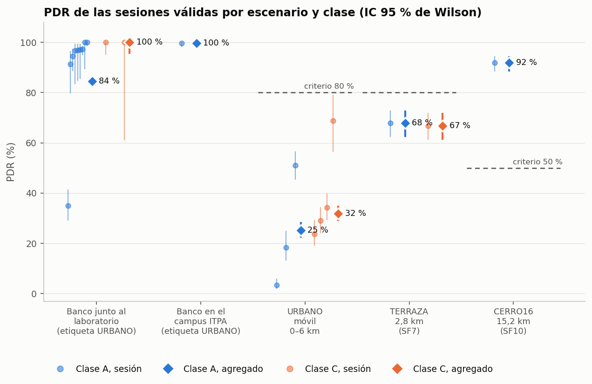
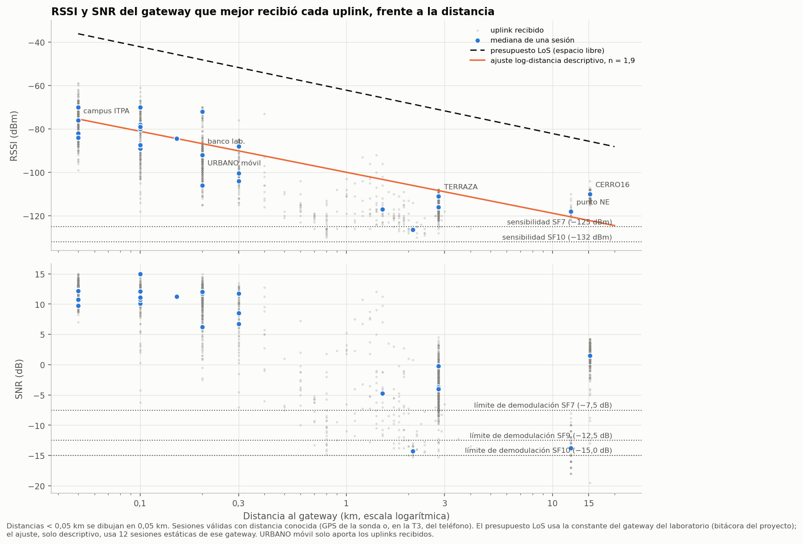
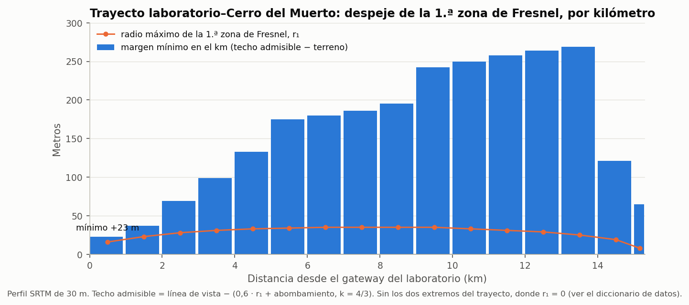
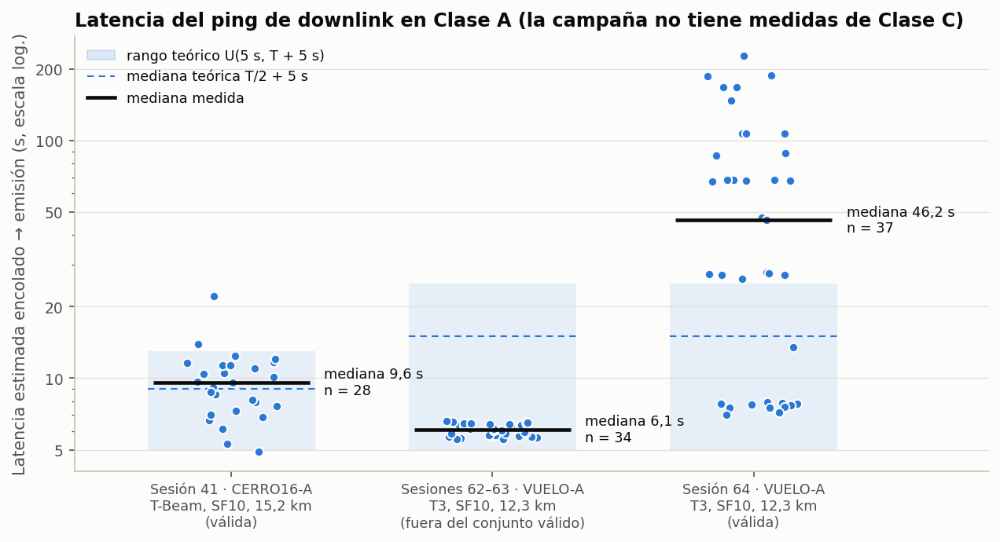
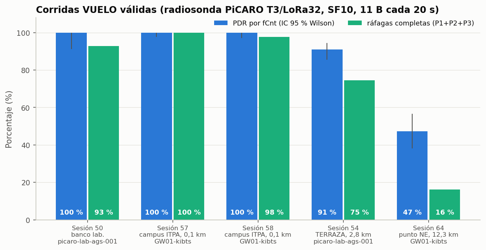

# T1 · Resultados experimentales de las pruebas de terreno

*Borrador del análisis estadístico (julio a octubre de 2026). Horas en el centro de México (UTC−6).*

Todas las cifras salen de los CSV anonimizados de `../datos/` mediante
[`../scripts/t1_analisis.py`](../scripts/t1_analisis.py) (`python -I t1_analisis.py`). Las tablas intermedias que se
citan aquí quedan en `t1_cifras/` y las figuras en `../figuras/t1_*.png`. Lo que es
inferencia y no medida directa se marca como **(inferido)**.

Sondas: **radiosonda PiCARO (T-Beam Supreme)**, con GPS, BME280 y PMU reales, y
**radiosonda PiCARO (T3/LoRa32)**, que simula los sensores (D-65). Gateways:
`picaro-lab-ags-001` (laboratorio en Aguascalientes), `ITPA-IOT-GW00` (SenseCAP) e
`ITPA-IOT-GW01-kibts` (Kerlink), los dos últimos en el campus del ITPA.

---

## 0. Conjunto de datos: 28 de 52 sesiones válidas

El criterio de `valida_para_analisis` está en `../datos/DICCIONARIO.md`. Tiene tres
condiciones: tamaño mínimo, que no sea banco con la etiqueta de otro escenario y que no
esté repetida. Además se excluye la sesión 66 por el incidente. Quedan fuera 24 sesiones,
y cada una cuenta una sola vez en esta tabla, por su motivo principal:

| Motivo principal | Sesiones | Cuáles |
|---|---|---|
| Abortada con N < 30 intentos (por debajo del mínimo de pings del protocolo) | 15 | 38, 42, 43, 45, 46, 47, 48, 53, 55, 56, 59, 60, 61, 62, 65 |
| Banco documentado con la etiqueta de otro escenario | 4 | 15, 16, 27 (CERRO16 de banco), 44 (VUELO de banco) |
| Repetida (abortada y rehecha el mismo día en el mismo sitio) | 4 | 1, 26, 37, 63 |
| Incidente (sesión abierta 10 días, 14 526 pings) | 1 | 66 |

Las sesiones 15, 16, 27 y 66 cumplen además la condición de N < 30. La tabla del
script ([`t1_cifras/exclusiones.csv`](t1_cifras/exclusiones.csv)) las cuenta en cada motivo que cumplen.

**Método del PDR.** Si la sesión tiene log de la microSD, PDR = recibidos / enviados por
el aire ([`pdr.csv`](../datos/pdr.csv), cruce de [`cruzar.py`](../../analisis/cruzar.py)). Si no lo tiene, se estima por los huecos de
fCnt ([`sesiones.csv`](../datos/sesiones.csv)), un método que no ve las pérdidas anteriores al primer uplink ni
las posteriores al último y que, por tanto, **sobrestima** el PDR. De las 28 sesiones
válidas, 12 tienen microSD. Las 16 restantes, entre ellas TERRAZA-A (19), CERRO16-A (41)
y todas las VUELO, usan el método de fCnt.

**Hay que separar por sitio.** La etiqueta URBANO agrupa dos cosas distintas: el
recorrido en vehículo (`URBANO_MOVIL`) y mediciones estáticas junto a un gateway
(`LAB_BANCO`, e `ITPA` en la sesión 40). En todo el análisis el escenario de propagación
se define por el sitio y no por la etiqueta.

---

## 1. PDR por escenario y clase

*Figura 1. Cada punto claro es una sesión y su barra es el IC 95 % de Wilson. El rombo
es el agregado de la celda. Las líneas discontinuas marcan el criterio pre-registrado:
80 % en URBANO y TERRAZA, 50 % en CERRO16.*

| Escenario (sitio) | Clase | Sesiones | Recibidos / intentados | PDR agregado [IC 95 %] | Rango por sesión | Criterio |
|---|---|---|---|---|---|---|
| URBANO móvil, 0–6 km, SF9 | A | 21, 23, 25 | 193 / 764 | **25,3 %** [22,3; 28,5] | 3,3–51,0 % | 80 % ✗ |
| URBANO móvil | C | 18, 22, 24, 28 | 294 / 922 | **31,9 %** [29,0; 35,0] | 23,8–68,9 % | 80 % ✗ |
| TERRAZA, 2,8 km, SF7 | A | 19 | 203 / 299 | **67,9 %** [62,4; 72,9] | — | 80 % ✗ |
| TERRAZA | C | 20 | 199 / 298 | **66,8 %** [61,2; 71,9] | — | 80 % ✗ |
| CERRO16, 15,2 km, SF10 | A | 41 | 275 / 299 | **92,0 %** [88,3; 94,5] | — | 50 % ✓ |
| CERRO16 | C | — | sin datos (42 y 43: 0 uplinks, A-11) | — | — | — |
| *Banco junto al laboratorio, SF9* | A | 2, 17, 29, 30, 32–35, 39 | 902 / 1068 | 84,5 % [82,2; 86,5] | 35,0–100 % | — |
| *Banco junto al laboratorio* | C | 3, 31 | 81 / 81 | 100 % [95,5; 100] | — | — |
| *Banco en el campus del ITPA* | A | 40 | 299 / 300 | 99,7 % [98,1; 99,9] | — | — |
| *Banco sin posición* | A | 36 | 300 / 300 | 100 % [98,7; 100] | — | — |

[`t1_cifras/pdr_por_celda.csv`](t1_cifras/pdr_por_celda.csv) y [`pdr_por_sesion.csv`](t1_cifras/pdr_por_sesion.csv). La tabla recoge 23 de las 28
sesiones válidas; las otras 5 son VUELO (§4). La sesión 36 no tiene posición. La
recibió `ITPA-IOT-GW00` a −22 dBm cuando ese gateway todavía no estaba en el ITPA, así
que es un banco sin sitio y no aparece en la figura **(inferido)**.

**Lectura.**

- **H1 (el PDR depende del escenario): se rechaza H0.** χ² = 563,6, gl = 2,
  p ≈ 4·10⁻¹²³, entre URBANO móvil, TERRAZA y CERRO16 ([`contrastes_pdr.csv`](t1_cifras/contrastes_pdr.csv)). El orden
  es el contrario al de la distancia: el escenario más lejano, el cerro, es el que mejor
  entrega. La geometría del trayecto pesa más que la distancia (§2).
- **H5 (enlace viable a ~15 km): se acepta.** PDR 92,0 % [88,3; 94,5] ≥ 50 % con un SNR
  mediano de +1,5 dB ≥ −15 dB. Es un PDR por fCnt: falta la microSD de la sesión 41.
- **Ningún escenario URBANO móvil ni TERRAZA cumple el 80 %.** El agregado de URBANO
  móvil infravalora la incertidumbre: la heterogeneidad entre sesiones es enorme (χ² de
  homogeneidad p ≈ 4·10⁻⁴¹ en A y 2·10⁻¹⁰ en C). Cada recorrido es un canal distinto. Es
  más honesto citar el rango por sesión (3–69 %) que el IC del agregado.
- **H2 (control: la clase no afecta al PDR).**
  - En **TERRAZA**, el único par A/C del mismo día y sitio, Δ = +1,1 pp, χ² = 0,08 y
    p = 0,77: **sin problema de método**. El control funciona donde el diseño se cumple.
  - En **URBANO móvil** sale Δ = −6,6 pp con p = 0,003, que formalmente cumple las dos
    condiciones de «problema de método». Pero las corridas A y C no recorrieron la misma
    ruta. La sesión 23 (3,3 %) estuvo casi parada a 2,1 km (0,3 km recorridos), y la
    heterogeneidad dentro de cada clase es mucho mayor que la diferencia entre clases.
    **(inferido)** La diferencia es del canal y no de la clase. Sin la sesión 23, la
    Clase A sube a 183/464 = 39,4 %, por encima de la C.
  - En el **banco del laboratorio** sale Δ = −15,5 pp, χ² = 14,7 y p = 1,2·10⁻⁴, que
    formalmente también es «problema de método». Pero no son corridas pareadas: la
    Clase A reúne 9 sesiones heterogéneas (35–100 %) y la C, solo 2 sesiones con 81
    paquetes. La diferencia la produce una sola sesión, la 29 (24-ago, 78/223 = 35 % a
    0,1 km), que no tiene explicación en los datos. Sin ella, la Clase A da
    824/845 = 97,5 % **(inferido)**. Conviene buscar la 29 en la bitácora de campo.
  - En los dos contrastes significativos no se cumplió el diseño (A y C pareadas en el
    mismo sitio y la misma ruta), así que no separan la clase del canal.

---

## 2. RSSI y SNR frente a la distancia, presupuesto de enlace y Fresnel

*Figura 2. Uplinks recibidos de las sesiones válidas con distancia conocida. Gris: cada
uplink. Azul: mediana de cada sesión. Discontinua: presupuesto en espacio libre de la
bitácora del proyecto. Naranja: ajuste log-distancia, solo descriptivo.*

| Sitio | SF | Uplinks | Distancia mediana | RSSI mediano | SNR mediano | SNR p10 | Margen de SNR en el p10 | Pérdida sobre el LoS |
|---|---|---|---|---|---|---|---|---|
| Campus del ITPA (GW00/GW01) | 9 / 10 | 288 / 84 | ≤ 0,1 km | −76 / −78 dBm | +12,2 / +15,0 dB | +10,1 / +15,0 dB | +22,6 / +30,0 dB | — |
| Banco del laboratorio | 9 | 592 | 0,2 km | −90 dBm | +11,5 dB | +7,5 dB | +20,0 dB | 42 dB |
| URBANO móvil (solo recibidos) | 9 | 483 | 0,2 km | −100 dBm | +8,8 dB | −10,8 dB | **+1,7 dB** | 52 dB |
| TERRAZA, T-Beam | **7** | 405 | 2,8 km | −116 dBm | −3,8 dB | −7,3 dB | **+0,2 dB** | 45 dB |
| TERRAZA, T3 | 10 | 85 | 2,8 km | −111 dBm | −0,2 dB | −5,0 dB | +10,0 dB | 40 dB |
| Punto NE (sesión 64, GW01) | 10 | 51 | 12,3 km | −118 dBm | −13,8 dB | −17,0 dB | **−2,0 dB** | 34 dB |
| CERRO16 | 10 | 275 | 15,2 km | −110 dBm | +1,5 dB | −1,0 dB | **+14,0 dB** | 24 dB |

[`t1_cifras/rf_por_sitio.csv`](t1_cifras/rf_por_sitio.csv). El margen es el SNR p10 menos el límite de demodulación
del SF (−7,5 dB en SF7, −12,5 dB en SF9 y −15 dB en SF10), el mismo método de la adenda
del 2026-09-28. La pérdida sobre el LoS es la diferencia entre el RSSI del presupuesto
en espacio libre y el RSSI mediano.

**Comparación con el presupuesto de enlace documentado.**

- El presupuesto de la bitácora del proyecto da −85,8 dBm a 15,27 km en LoS y
  un margen de +44 a +47 dB en SF10. La constante que se deduce es PIRE + G_rx = 29,5 dB,
  y la sensibilidad, −132 dBm en SF10 y −125 dBm en SF7. **Medido en el cerro: −110 dBm,
  24 dB por debajo del LoS**, lo que confirma la nota de la bitácora («~25 dB
  optimista»). El margen real de SNR en el p10 es de +14 dB y no de +44. El pronóstico
  hecho con *n* = 2 desde el mejor punto de banco (−108,7 dBm) se cumplió dentro de
  2 dB.
- **Ajuste log-distancia (descriptivo, no es un modelo de propagación).** Doce sesiones
  estáticas recibidas por el gateway del laboratorio (banco, terraza y cerro, de 0,1 a
  15,2 km) dan **n = 1,89**, RSSI(1 km) = −100 dBm y una desviación típica residual de
  9,0 dB ([`ajuste_log_distancia.csv`](t1_cifras/ajuste_log_distancia.csv)). El ajuste mezcla bancos urbanos sin línea de
  vista a 0,1–0,3 km con un único punto en línea de vista a 15,2 km. Un exponente menor
  que 2 sale de esa mezcla y del sesgo de los sitios, no de la propagación. Con
  σ = 9 dB predice poco: en el cerro daría unos −122 dBm y se midieron −110 dBm, 12 dB
  por encima, lo esperable en LoS limpio. La pérdida sobre el LoS de la tabla tampoco es
  fija: va de 24 a 52 dB según el sitio. **(inferido)** Una parte común a todos apunta a
  la instalación (pérdidas de cable y conectores, ganancia real de las antenas, la sonda
  a 1,5 m del suelo); el resto depende de la geometría de cada trayecto.
- **El SF es lo que separa TERRAZA de CERRO16, no la distancia.** En TERRAZA con SF7 el
  SNR mediano (−3,8 dB) está a solo +3,7 dB del límite de SF7, y el p10 cae justo en él
  (+0,2 dB de margen). El 33 % de pérdidas es la cola de paquetes por debajo del umbral.
  Con SF10, en el mismo sitio, la T3 tiene +10 dB de margen en el p10 y un PDR del 90,9 %
  (§4).
- **Piso de ruido aparente (inferido).** En los paquetes con SNR < 0, RSSI − SNR da
  entre −111 y −114 dBm en el gateway del laboratorio (cerro −110,8, terraza −111/−113,
  banco −113,8 dBm). El ruido térmico de 125 kHz con NF = 6 dB es de −117 dBm. El
  laboratorio trabaja con un piso **3 a 6 dB por encima del térmico**, compatible con
  interferencia urbana. Es una estimación indirecta, no una medida del espectro.

**Fresnel (perfil SRTM 30 m, [`perfil_cerro.csv`](../datos/perfil_cerro.csv)).**

*Figura 3. Margen mínimo de cada kilómetro sobre el techo admisible: LoS − (0,6·r₁ +
abombamiento con k = 4/3). El perfil fino no se publica porque permitiría situar el
laboratorio.*

El tramo interior del trayecto está despejado. El margen mínimo es de **+23 m en el
primer kilómetro**, en el entorno urbano junto al gateway, y la mediana de los mínimos
por kilómetro, de 178 m. El radio máximo de la primera zona es r₁ = 35 m en el punto
medio. Coincide con el cierre de A-03. Los extremos no entran en el mínimo: ahí r₁ = 0
y el margen es la altura de cada antena sobre el SRTM. La línea de vista usa como
altitud de la sonda la mediana de su GPS en la cima más 1,5 m (2274 + 1,5 m); el SRTM
da 2269 m, así que la sonda queda 6,5 m por encima, una diferencia dentro del error de
ambos en un pico (`DICCIONARIO.md`). El PDR del 92 % en el cerro y su pérdida sobre el LoS (24 dB, la menor de todos
los sitios) son coherentes con un trayecto sin obstrucción de terreno. Las pérdidas
fueron sueltas y concentradas en 905,3 MHz (A-12, de [`cerro_20260927.py`](../../analisis/cerro_20260927.py)), lo que
apunta a interferencia y no a geometría.

---

## 3. Clase A frente a Clase C: entrega de downlinks, latencia del ping y RTT

### 3.1 Lo que hay y lo que falta

> **Corregido el 2 de noviembre de 2026.** La versión vigente de esta sección es la §4.3 del
> [reporte](../REPORTE-PRUEBAS-TERRENO.md). Allí se reconstruye la clase efectiva del
> servidor en cada sesión ([`../datos/clase_efectiva.csv`](../datos/clase_efectiva.csv)) y se usan los downlinks que la
> sonda registró en su microSD ([`../datos/downlinks_recibidos_sd.csv`](../datos/downlinks_recibidos_sd.csv)). Este borrador
> decía antes que la sonda no registraba los downlinks y que no había ninguna medida de
> downlink en Clase C. Las dos cosas eran incorrectas.

- **Sí hay downlinks recibidos en Clase C, pero no su latencia.** Con la clase alineada en
  la sonda y en el servidor, la sonda registró 4 pings en 3 sesiones: 3 en la 20 y 1 en la 24
  (la 28, con 0). Eran pings manuales, anteriores a la tabla de envíos (D-61), así que
  falta la hora de envío. Las sesiones 42 y 43 del cerro tuvieron 0 uplinks porque la sonda
  no completó el join (A-11), y la 31 no tiene microSD.
- **H4 (latencia menor en Clase C) no se puede contrastar.** La U de Mann-Whitney
  necesita las dos muestras. Lo único que se puede evaluar es la mitad A del criterio
  (mediana(A) ≥ 0,4 × intervalo), y se cumple en las sesiones válidas 41 y 64.
- **El RTT extremo a extremo con la microSD no es fiable.** El reloj de la sonda tenía
  desfases de minutos respecto al servidor. Lo que sí confirma la microSD es que en
  Clase A cada ping llegó por RX1, entre 5 y 6 s después del uplink. Lo que sigue es la
  emisión por el aire (txack) y una cota de red.

### 3.2 Entrega (emisión) de downlinks en Clase A

| Sesión | Sonda · sitio | Pings en la ventana con txack | Emitidos (txack) | Fracción |
|---|---|---|---|---|
| 41 (válida) | T-Beam · CERRO16 | 29 | 28 | **96,6 %** |
| 64 (válida) | T3 · punto NE | 39 | 37 | **94,9 %** |
| 62 (N < 30) | T3 · punto NE | 9 | 8 | 88,9 % |
| 63 (repetida) | T3 · punto NE | 32 | 26 | 81,3 % |

[`t1_cifras/entrega_downlinks.csv`](t1_cifras/entrega_downlinks.csv). En la 41 la captura de txack empieza a las 08:17
locales, así que solo cuentan los pings encolados desde entonces. Todos salieron por
**RX1** (`ventana`). Que un ping se emita no significa que la sonda lo reciba: eso
requiere la microSD. Las cuatro pruebas de banco del 29 y 30 de agosto registraron
6–8 downlinks cada una, todos por RX1, según la bitácora (A-09). Ese dato no está en los
CSV publicados.

### 3.3 Latencia del ping (Clase A)

*Figura 4. lat_tx_estimada = uplink que abre la ventana + 5 s (RX1) − encolado
(inferido, ver DICCIONARIO). Franja: rango teórico U(5 s, T + 5 s) con T = periodo de
uplink. Línea azul discontinua: mediana teórica T/2 + 5 s.*

| Grupo | n | T (s) | Mediana medida [p25–p75] | Mediana teórica | Rango medido | Por encima de T + 5 s |
|---|---|---|---|---|---|---|
| 41 · CERRO16-A (válida) | 28 | 8,0 | **9,6 s** [7,6–11,4] | 9,0 s | 4,9–22,2 s | 7,1 % |
| 62–63 · VUELO-A (no válidas) | 34 | 20,0 | 6,1 s [5,7–6,4] | 15,0 s | 5,6–6,6 s | 0 % |
| 64 · VUELO-A (válida) | 37 | 20,0 | **46,2 s** [7,9–88,1] | 15,0 s | 7,0–226,9 s | 67,6 % |

[`t1_cifras/latencia_clase_a.csv`](t1_cifras/latencia_clase_a.csv).

- **Cerro (41): el modelo de Clase A se cumple.** La mediana medida (9,6 s) está a 0,6 s
  de la teórica, y la fracción por encima de T + 5 s (7,1 %) coincide con la tasa de
  pérdida de uplinks de la sesión (8,0 %). Cuando se pierde el uplink que debía abrir la
  ventana, el ping espera un periodo más. Es el comportamiento esperado.
- **Sesiones 62–63: latencia de ~6 s, pero es un artefacto de fase (inferido).** El ping
  se encoló siempre entre 0,55 y 1,62 s antes de un uplink. El ciclo de ping (60 s) es
  múltiplo exacto del de VUELO (20 s), así que la fase se conserva de un ping al
  siguiente y solo deriva unos 40 ms por minuto. Estas latencias **no representan** la
  de un comando que llega en un instante al azar, que tendría una mediana de ~15 s.
- **Sesión 64: con un enlace degradado, la Clase A se dispara.** Con el 47 % de PDR, el
  68 % de los pings superó T + 5 s y el máximo llegó a 227 s. Para un comando de corte,
  esto es lo que justifica la Clase C (o redundancia en el uplink) en el borde de
  cobertura.

### 3.4 RTT de red (inferido)

`dt(uplink → txack)` por gateway ([`rtt_uplink_txack.csv`](t1_cifras/rtt_uplink_txack.csv)):

| Gateway | Protocolo | n | Mediana | Rango | Qué mide |
|---|---|---|---|---|---|
| ITPA-IOT-GW00 | Semtech UDP | 14 | **0,64 s** | 0,63–0,73 s | El ack llega al aceptar la orden: subida al LNS, deduplicación y proceso, bajada al gateway y ack |
| ITPA-IOT-GW01-kibts | Semtech UDP | 57 | 5,05 s | 5,04–5,06 s | Confirma tras emitir en RX1 (5 s) |
| picaro-lab-ags-001 | Basics Station | 28 | 5,26 s | 5,25–5,42 s | Confirma tras emitir en RX1 (5 s) |

El dato de `ITPA-IOT-GW00` es la mejor cota disponible del **tiempo de ida y vuelta
gateway ↔ LNS más el proceso de ChirpStack: ~0,64 s**. Incluye la ventana de
deduplicación, así que no es solo el RTT de red (servidor remoto, con ~180 ms de ida y
vuelta según la bitácora). **(inferido)** En Clase C el comando sale por RX2 (923,3 MHz,
SF12/500 kHz): a los 0,5–1 s de red hay que sumar unos 250–290 ms en el aire. La
latencia esperada queda **en el umbral de 1 s de H4 o por encima**, no por debajo.

**Dato externo: Clase C medida en SatLink 2026.** La sonda Orbitium (Sci-Fi), ITPA, voló en Clase C sobre
el mismo servidor y los gateways del ITPA. En sus 50 downlinks, del encolado al txack
pasó una mediana de **≈ 1,5 s** (1,19 s por `ITPA-IOT-GW00`, que confirma al aceptar, y
2,10 s por `ITPA-IOT-GW01-kibts`, que confirma tras emitir), con una resolución de 1 s
en la hora de encolado ([reporte de SatLink 2026](https://github.com/ovelazquezj/radiosonda_PIcaro/blob/master/docs/reportes/satlink-2026/REPORTE-SATLINK-2026.md),
[`downlinks.csv`](../datos/downlinks.csv)). Es otra sonda, otro firmware y otra campaña, así que H4 sigue sin
contrastarse, pero confirma el orden de magnitud: 1–2 s en Clase C frente a 9,6 s de
mediana en Clase A en el cerro.

---

## 4. Corridas VUELO: telemetría de 11 bytes, T-Beam frente a T3/LoRa32

El formato (D-64) manda 11 bytes por paquete en DR0/SF10, tres paquetes por ráfaga
(P1 posición, P2 ambiente, P3 navegación) y uno cada 20 s. Tiempo en el aire de cada
paquete (24 B PHY, SF10/125 kHz, CR 4/5): **370,7 ms**, el mismo valor que midió la
bitácora (371 ms). Ciclo de trabajo: **1,85 %**.

*Figura 5. Sesiones VUELO válidas, todas de la T3/LoRa32. PDR por fCnt (IC 95 % de
Wilson) y fracción de ráfagas con los tres paquetes.*

| Sesión | Sitio | Gateway principal | Distancia | PDR por fCnt [IC 95 %] | Ráfagas completas | (PDR)³ | SNR mediano |
|---|---|---|---|---|---|---|---|
| 50 | Banco del laboratorio | picaro-lab-ags-001 | < 0,1 km | 100 % [91,2; 100] | 13/14 (92,9 %) | 100 % | +12,3 dB |
| 57 | Campus del ITPA | ITPA-IOT-GW01-kibts | 0,1 km | 100 % [97,7; 100] | 55/55 (100 %) | 100 % | +15,0 dB |
| 58 | Campus del ITPA | ITPA-IOT-GW01-kibts | 0,1 km | 100 % [97,1; 100] | 42/43 (97,7 %) | 100 % | +15,0 dB |
| 54 | TERRAZA | picaro-lab-ags-001 | 2,8 km | 90,9 % [85,5; 94,4] | 41/55 (74,5 %) | 75,1 % | +0,3 dB |
| 64 | Punto NE | ITPA-IOT-GW01-kibts | 12,3 km | 47,3 % [38,2; 56,5] | 6/37 (16,2 %) | 10,6 % | −13,9 dB |

[`t1_cifras/vuelo_por_sesion.csv`](t1_cifras/vuelo_por_sesion.csv). La columna (PDR)³ es la fracción de ráfagas completas
que se esperaría si cada paquete se perdiera de forma independiente.

- **Las ráfagas se completan como predicen las pérdidas independientes.** En TERRAZA se
  esperaba el 75,1 % y se midió el 74,5 %, así que repartir los tres paquetes cada 20 s
  cumple su objetivo (D-64): no hay ráfagas perdidas enteras. En la 64 se completan algo
  más de las esperadas (16,2 % frente a 10,6 %), señal de pérdidas algo agrupadas en el
  tiempo. En 50 y 58, con un 100 % de PDR, la ráfaga que falta es la última, cortada al
  cerrar la sesión.
- **Diversidad en el ITPA.** En 57 y 58, el 97 % de los uplinks llegaron por los dos
  gateways del ITPA.
- **Punto NE (12,3 km): 63 frente a 64 (inferido).** La sesión 63 (repetida, no válida)
  dio un 97,5 %, con SNR +6,0 dB en GW01 y un 94 % de los uplinks también por GW00.
  Minutos después, en el mismo sitio, la 64 bajó al 47,3 %, con SNR −13,8 dB y solo un
  8 % por GW00 ([`punto_ne_62_64.csv`](t1_cifras/punto_ne_62_64.csv)). El RSSI cayó 8 dB y el SNR 20 dB, y los dos
  gateways empeoraron a la vez. Algo cambió en la sonda (colocación u orientación de la
  antena) o en el entorno común. Ningún registro lo confirma. La regla mecánica de
  «repetida» deja como válida la peor de las dos, y conviene que el analista la revise.
  Con la 63 como referencia, el enlace de superficie a 12,3 km de los gateways del ITPA
  tiene un margen de SNR sobre el límite de SF10 de +21 dB en la mediana y +14 dB en el
  p10 (mejor gateway), lo que es relevante para el lanzamiento.

### 4.1 T-Beam frente a T3/LoRa32

**No hay una comparación válida y directa en VUELO.** Las únicas corridas VUELO de la
T-Beam son de banco (44, con 9/9 uplinks y 3/3 ráfagas, y 45, con 3/3), excluidas por el
criterio. En banco las dos sondas entregan el 100 %. La T3 completó 13 de 14 ráfagas en
la sesión 50 (la que falta es la final). Ninguna de las dos falla en el formato de
11 bytes: el decoder y el microservicio las tratan igual, como fijó D-65.

La única comparación en el mismo sitio es en TERRAZA, a 2,8 km del laboratorio
([`terraza_tbeam_vs_t3.csv`](t1_cifras/terraza_tbeam_vs_t3.csv)):

| | T-Beam (sesiones 19 y 20, ago) | T3 (sesión 54, oct) |
|---|---|---|
| Corrida | TERRAZA-A/C, **SF7** | VUELO-A, **SF10** |
| PDR | 402/597 = **67,3 %** | 150/165 = **90,9 %** |
| RSSI / SNR medianos | −116 dBm / −3,8 dB | −111 dBm / −0,2 dB |
| Margen de SNR en el p10 | +0,2 dB | +10,0 dB |

χ² = 36,0, p = 2·10⁻⁹. Pero **la diferencia está confundida** con el SF (unos 7,5 dB de
límite de demodulación), la placa y su antena, el payload y la fecha. **(inferido)** La
mayor parte se explica por el SF: con SF7 la T-Beam trabajaba en el límite. Que la T3
reciba 5 dB más de RSSI en el mismo sitio es una diferencia de instalación o de antena
que no se puede aislar con estos datos.

Los sensores de la T3 son simulados (D-65), así que en VUELO solo se compara el enlace,
no la telemetría.

---

## 5. Conclusiones

1. **La geometría manda sobre la distancia.** CERRO16 (15,2 km, LoS) entrega el 92 %,
   TERRAZA (2,8 km) el 67 % y URBANO móvil (0–6 km, NLOS) entre el 3 y el 69 %. H1 se
   rechaza (p ≈ 4·10⁻¹²³) y H5 se acepta.
2. **El presupuesto en espacio libre es optimista en 24 dB en el mejor caso (cerro) y en
   34–52 dB en el resto.** El ajuste log-distancia (n ≈ 1,9, σ ≈ 9 dB) es solo
   descriptivo: mezcla geometrías y no sirve como modelo de propagación. Para planificar
   conviene partir de medidas en sitios con una geometría parecida a la del destino.
3. **SF7 no tiene margen ni a 2,8 km en este entorno.** El p10 de SNR en TERRAZA cae en
   el límite de demodulación. SF10 en el mismo sitio deja +10 dB.
4. **El control H2 funciona donde el diseño se cumple** (TERRAZA, Δ = 1,1 pp). En URBANO
   móvil y en el banco del laboratorio sale significativo, pero las corridas no son
   pareadas y la «diferencia» de clase es variabilidad del canal (inferido).
5. **Clase A frente a C sigue sin medirse.** La Clase A se comporta según el modelo
   (mediana 9,6 s frente a 9,0 s teóricos en el cerro) y empeora mucho con el PDR bajo
   (mediana 46 s y máximo 227 s). De la Clase C no hay ni un dato propio; el único es
   externo (SatLink 2026, ≈ 1,5 s del encolado al txack).
6. **Telemetría VUELO de 11 bytes:** 370,7 ms y un ciclo de trabajo del 1,85 %. Las
   ráfagas se completan como predicen las pérdidas independientes y hay diversidad de
   gateways en el ITPA. A 12,3 km del ITPA el enlace es bueno en la sesión 63 y malo en
   la 64, sin causa registrada.

## 6. Recomendaciones

- Repetir CERRO16-C y una pareja A/C en un sitio fijo con el ping activo, para tener por
  fin las dos muestras de H4. Hay que comprobar el join tras el cambio de clase (A-11).
- Que la sonda registre la recepción de cada downlink (seq e instante GPS) en la microSD
  y cruzarla con el encolado. Sin eso no hay RTT ni tasa de recepción real.
- **Desfasar el ciclo de ping** (por ejemplo, un intervalo aleatorio entre 45 y 75 s)
  para que no quede enganchado en fase con el uplink. Si no, la latencia de Clase A
  sale artificialmente baja (62–63).
- Que el ciclo de ping se corte solo tras N minutos sin uplinks (incidente de la 66).
- Descargar la microSD de la sesión 41 para sustituir el PDR por fCnt.
- Revisar en la bitácora de campo la sesión 29 (banco, 35 %) y el cambio entre las
  sesiones 63 y 64.
- Usar SF10 (DR0) en cualquier enlace de más de ~2 km en este entorno.
- **Lección del evento, mencionada solo como contexto:** una de las sondas preparadas
  para SatLink 2026 no voló tras un corte falso en mesa, causado por un BME280 dañado y
  un GPS defectuoso.
  Una humedad pegada al 100 % es síntoma de sensor dañado. Conviene filtrar los sensores
  antes de cualquier lógica de liberación.

## 7. Limitaciones

- En 16 de las 28 sesiones válidas el PDR se estima por los huecos de fCnt, que lo
  sobrestima.
- El sitio de cada sesión es inferido (mediana y dispersión de posiciones). En 8
  sesiones sin GPS se supone banco.
- En URBANO móvil solo hay distancia de los uplinks recibidos (la posición de los
  perdidos está en la microSD, que no se publica por uplink). La figura 2 no muestra dónde se pierden los
  paquetes, y la distancia mediana de URBANO (0,2 km) está sesgada hacia el gateway.
- La latencia es la emisión estimada, no la recepción. El emparejamiento ping-txack
  (seq = fCntDown + k) es inferido.
- En las sesiones 62–63, que se usan solo para latencia y RTT, no se aplica el criterio
  de validez del PDR. Se señalan como tales.
- Las distancias a `ITPA-IOT-GW00` usan su posición actual y no son válidas antes del
  7-sep (solo afecta a la sesión 36, que no tiene posición).
